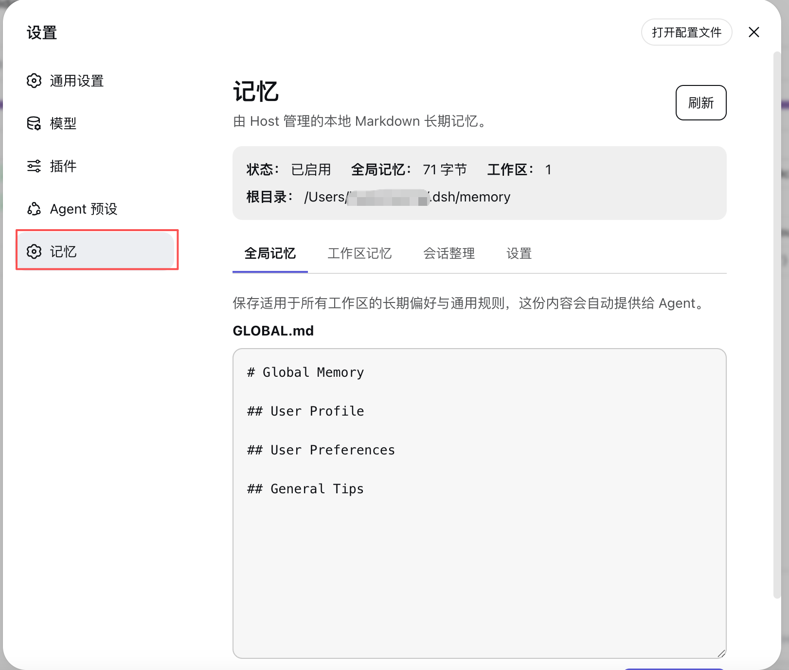

<p align="center">
  
</p>

<h1 align="center">dsh-memory</h1>

<p align="center">
  DeepSeek Harness 的 Markdown 长期记忆：全局与 Workspace 分层管理，按需渐进式披露。
</p>

<p align="center">
  中文 · <a href="README.en.md">English</a>
</p>

<p align="center">
  
  
</p>

<div align="center">

[核心能力](#核心能力) · [安装](#安装) · [开始使用](#开始使用) · [数据与隐私](#数据与隐私) · [文档](#文档)

</div>

## 为什么需要它

普通 Session 结束后，Agent 很容易忘记用户偏好、项目约束和已经验证过的经验。`dsh-memory` 把这些长期信息保存在用户本机的 Markdown 文件中，并在后续请求中只提供 Global 记忆和当前 Workspace 的记忆索引。

它不依赖外部记忆数据库或专用记忆服务，也不把所有历史对话塞回上下文：Agent 先看到小型索引，再使用 DSH 已有的文件搜索工具按需读取少量详细记忆。

## 核心能力

| 能力 | 说明 |
|---|---|
| 本地 Markdown | 权威记忆保存在 `$DSH_HOME/memory`，用户可以直接阅读和备份 |
| Global / Workspace 隔离 | Global 保存跨项目偏好；项目事实只进入当前 Workspace |
| 渐进检索 | 自动注入 Global 与当前 Workspace 索引，详细文件按需打开 |
| 安全写入 | Agent 与 Web UI 使用同一套写入机制，检测到并发修改时拒绝直接覆盖 |
| 会话整理 | 从已结束且稳定的 DSH Session 中提取候选长期记忆，校验后安全写入 |
| 可观察性 | 每次整理保存结果记录；可选 Debug 日志记录阶段和错误链，但不复制对话正文或凭据 |
| 双语界面 | Memory 页面跟随 DSH Web 的中文或英文 locale |

## 工作方式

```text
Agent 请求
  └─ Global 记忆 + 当前 Workspace 的 MEMORY.md
       └─ Agent 按需搜索详细 Markdown

已结束的 DSH Session
  └─ 用户手动触发整理
       └─ 独立的整理 Agent 提出记忆变化
            └─ Host 校验证据、记忆归属和数据版本
                 └─ MemoryStore 原子写入并保存结果
```

模型只负责提出记忆变化；记忆归属、内容校验、版本检查和最终写入均由确定性的 Host 代码负责。

## 界面

Memory 会作为 DSH Settings 中的独立栏目出现：

| 页面 | 用途 |
|---|---|
| 全局记忆 | 查看和编辑自动提供给所有 Workspace 的 `GLOBAL.md` |
| 工作区记忆 | 浏览、创建、修改和删除当前项目的详细记忆 |
| 会话整理 | 按 Workspace 浏览稳定 Session，触发整理并查看最近结果 |
| 设置 | 从 DSH 已激活的文本模型中选择整理模型，并按需开启 Debug 日志 |



## 安装

### 环境要求

- 已安装 DeepSeek Harness，并且 `dsh web` 可以正常启动。
- 从源码构建还需要 Node.js `^22.19.0 || >=24.0.0` 和 pnpm。

### npm 安装

通过 npm 安装：

```sh
dsh plugin --profile web add @hr98w/dsh-memory
```

安装完成后请完全重启 `dsh web`。

### 从源码安装

克隆仓库后，在仓库根目录执行：

```sh
pnpm install
pnpm run build
dsh plugin --profile web add .
```

然后完全重启 `dsh web`。Bundle 层和 Host ESM 入口在启动时加载，仅刷新浏览器不会应用 Host 代码变化。

## 开始使用

1. 在 DSH 的 Models 页面配置并激活至少一个文本模型；API key 始终由 DSH 管理。
2. 打开“设置 → 记忆 → 设置”，选择 Session 整理使用的模型。
3. 在“全局记忆”保存跨项目偏好，在“工作区记忆”管理项目事实和约束。
4. 在“会话整理”中选择一个已经结束且稳定的 Session，点击整理。
5. 整理完成后检查结果；如需排错，可在设置页开启 Debug 后重新触发。

## 数据与隐私

默认数据布局：

```text
$DSH_HOME/memory/
├── GLOBAL.md
├── settings.yml
├── consolidator-workspace/             # 内部整理 Session 的专属 cwd
├── debug/<review-id>/attempt-<n>.jsonl # 仅在用户开启 Debug 后写入
├── reviews/<review-id>.md
└── workspaces/<workspace-key>/
    ├── MEMORY.md                        # 自动生成的索引
    └── <memory-name>.md                 # 权威详细记忆
```

- Web 管理接口只允许本机访问；
- Web 页面不会接收记忆根目录、绝对路径、cwd 或内部 Workspace key；
- Debug 默认关闭，不记录对话证据、记忆正文、模型提议正文或 API key；
- `MEMORY.md` 是可重建索引，详细 Markdown 文件才是 Workspace 权威数据。

“本地优先”指权威记忆保存在本机，并不表示所有模型处理都离线完成。正常 Agent 请求会把当前可见的记忆上下文发送给该 Agent 使用的模型；手动 Session 整理会把筛选后的对话内容和当前 Workspace 记忆发送给设置页选择的模型服务商。请根据所用服务商的隐私政策决定是否启用相关功能。

安全问题请查看 [SECURITY.md](SECURITY.md)。

## 开发与验证

```sh
pnpm run typecheck
pnpm run test
pnpm run build
pnpm run check
```

提交代码前运行 `pnpm run check`。不同改动对应的人工验证方式见 [docs/development.md](docs/development.md)。贡献流程见 [CONTRIBUTING.md](CONTRIBUTING.md)。

## 文档

- [架构](docs/architecture.md)：已实现组件和 Host/Browser 请求流；
- [设计](docs/design.md)：稳定产品规则与第一版边界；
- [Session 整理设计](docs/session-consolidation.md)：完整流程、状态机和数据契约；
- [路线图](docs/roadmap.md)：已完成里程碑与后续方向；
- [开发指南](docs/development.md)：命令、验证矩阵和发布步骤；
- [决策记录](docs/decisions/implemented/)：非平凡架构、行为和协议选择。

## License

[MIT](LICENSE) © 2026 hr98w
