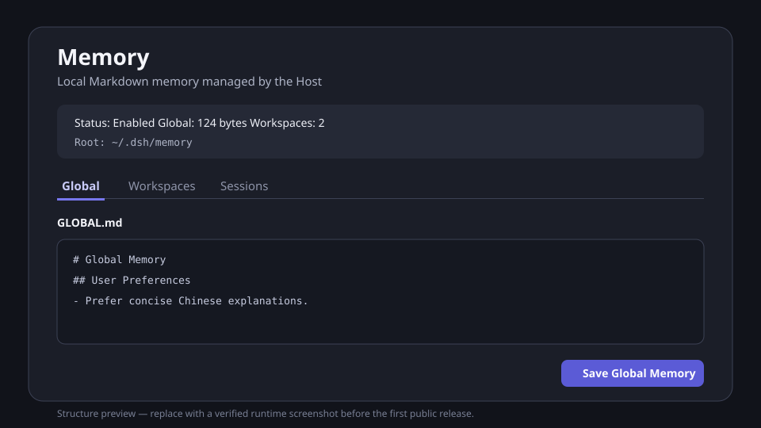

<h1 align="center">dsh-memory</h1>

<p align="center">
  为 DeepSeek Harness 提供本地优先、Markdown 可读、可渐进检索的长期记忆。
</p>

<p align="center">
  
  
</p>

> 当前状态：首个可运行基础里程碑。Global/Workspace Markdown 存储、Prompt 注入、`memory_update`、loopback RPC 和 Global 设置页已经实现；下一项工作是 Workspace 管理，之后是 Session Consolidator。

## 它解决什么问题

`dsh-memory` 让 Agent 在 Session 之外保留长期信息，同时把权威数据留在用户可直接阅读和编辑的 Markdown 文件中。Global 记忆自动进入运行时上下文；当前 Workspace 只自动进入派生索引，Agent 再通过已有文件搜索和读取工具按需打开少量详细记忆。

运行时文件默认位于：

```text
$DSH_HOME/memory/
├── GLOBAL.md
└── workspaces/<workspace-key>/
    ├── MEMORY.md
    └── <memory-name>.md
```

## 当前能力

### Host 能力

| 能力 | 状态 | 说明 |
|---|---|---|
| Markdown MemoryStore | 已实现 | Global 与 Workspace 读取、revision、CAS 写入和 Workspace 索引重建 |
| Prompt 注入 | 已实现 | 自动加载 Global 和当前 Workspace `MEMORY.md`，详细文件按需搜索 |
| Loopback RPC | 部分实现 | 已实现 Status、Global 读取和 revision-checked 替换 |
| Session Consolidator | 待实现 | 从稳定的持久化 Session 中提取并合并 Workspace 记忆 |

### Tools

| 工具 | 作用 |
|---|---|
| `memory_update` | 完整替换 Global，或在当前 Workspace 创建、替换、删除一条记忆；所有写入携带 expected revision |

### Browser UI

| 页面 | 状态 | 作用 |
|---|---|---|
| Global | 已实现 | 查看、编辑并 CAS 保存 `GLOBAL.md` |
| Workspaces | 待实现 | 浏览派生索引与详细记忆，执行批量 mutation |
| Sessions | 待实现 | 选择稳定 Session，手动触发 Consolidator 并查看 receipt |



## 本地开发

```sh
pnpm install
pnpm run check
```

从包根安装到本地 Web profile：

```sh
pnpm run build
dsh plugin --profile web add ../dsh-memory
```

Bundle 层在启动时合成，因此安装或修改 Host 入口后需要重启 `dsh web`。只更新已经安装的 Browser bundle 时，重新构建、重新安装并刷新页面。

## npm 安装

首个公开版本发布后：

```sh
dsh plugin --profile web add @hr98w/dsh-memory
```

真实 Web 安装冒烟已经通过；公开发布前仍需补充真实 UI 截图。不要把当前未发布的包名当作已经可安装的 registry 版本。

## 插件管理

已装插件可以使用 plugin-registry 的薄控制台管理 profile 安装态，无需手改配置：

```sh
dsh plugin --profile web add "github:vlln/plugin-registry#path:/packages/plugin/console"
```

## 文档

- [贡献指南](AGENTS.md)：进入仓库后的开发规则、不变量和阅读顺序；
- [架构](docs/architecture.md)：已经实现的组件与 Host/Client 数据流；
- [设计](docs/design.md)：稳定产品规则和第一版边界；
- [路线图](docs/roadmap.md)：按依赖排序的后续功能；
- [开发](docs/development.md)：命令、验证矩阵与发布纪律；
- [首个架构决策](decisions/implemented/architecture/2026-08-28-host-client-foundation.md)：为什么第一条实现竖切从这些组件开始。

## 安全边界

- Browser 管理 API 只注册在 Connection 的 `loopback` channel；
- Browser 不能提交 memory root 或任意文件路径；
- 模型写入 Workspace 时只使用执行 Agent 的 Session cwd；
- revision 冲突拒绝覆盖，调用方必须重新读取；
- v0.1 的详细记忆读取依赖 Prompt policy，不构成敌对输入下的文件权限隔离。

## License

[MIT](LICENSE)
